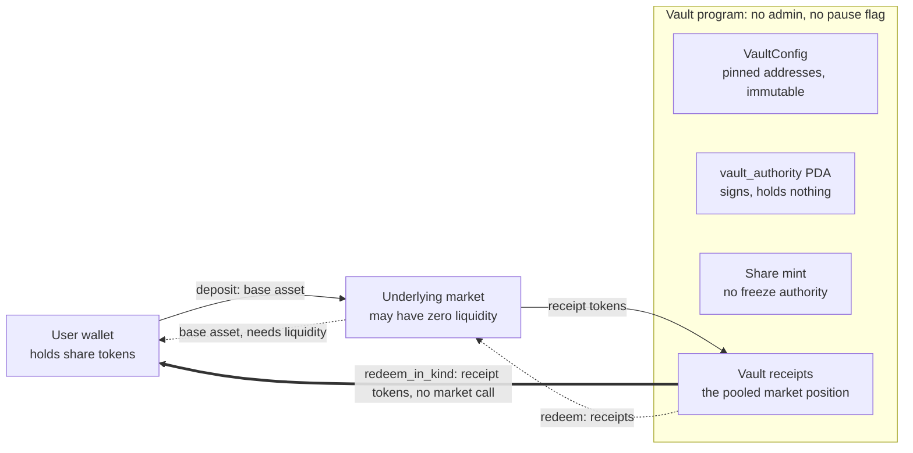
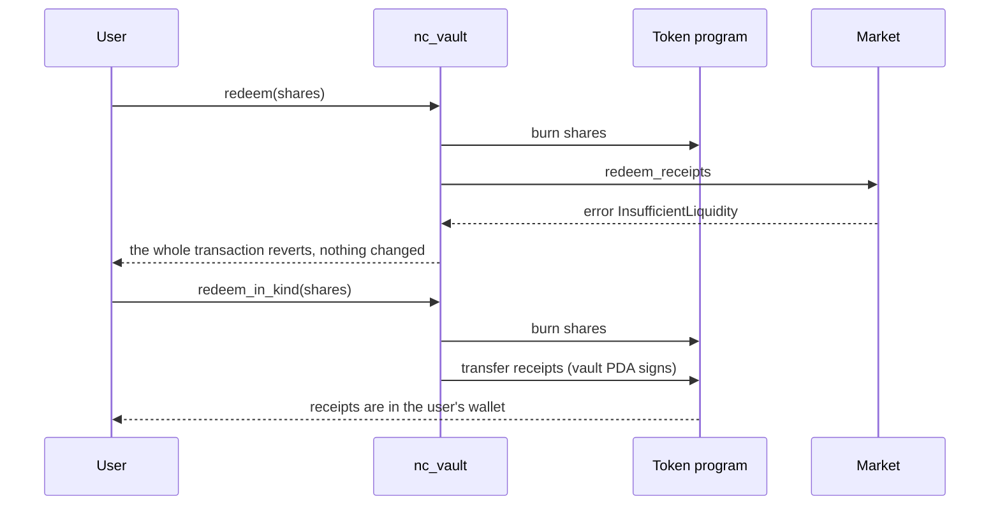

# Non-custodial vault with in-kind redemption

A design for a vault that nobody can freeze, pause or take funds from, where every user can leave at any time, even when the market the vault deposits into has no cash to give back.

The reference implementation is [`programs/nc_vault`](programs/nc_vault). It is tested with [LiteSVM](https://github.com/LiteSVM/litesvm) against a small mock lending market, [`programs/mock_market`](programs/mock_market), which can be told to run out of liquidity.

## The requirement

> Design the vault to be non-custodial, such that users can redeem vault position in kind (for an underlying market position, even when the vault has no available liquidity) and users can exit anytime.

Three requirements are hiding in that sentence:

| #   | Requirement                          | What it means for the design                                                                                                                 |
| --- | ------------------------------------ | -------------------------------------------------------------------------------------------------------------------------------------------- |
| 1   | Non-custodial                        | No person, key or contract can move, freeze or block a user's claim. The only thing that can move funds is a fixed program rule.             |
| 2   | Redeem in kind                       | Besides getting the base asset back (say USDC), a user can leave with their slice of the vault's actual market position, the receipt tokens. |
| 3   | Exit anytime, even with no liquidity | No lock-ups, queues, pause switches or dependencies. The in-kind exit must work when the market cannot pay out the base asset.               |

## The design in one picture



The thick arrow is the whole point. Redeeming in kind moves tokens the vault already holds, so it never asks the market for anything. The dotted route is the usual "give me my base asset back" exit, which only works while the market has cash. Everything else in this design exists to protect the thick arrow.

## Accounts

| Account            | Address                                                               | Owner          | What it is                                                                       |
| ------------------ | --------------------------------------------------------------------- | -------------- | -------------------------------------------------------------------------------- |
| `config`           | PDA of `["config", market_program, reserve, base_mint, receipt_mint]` | vault program  | The pinned parameters. Written once, never modified.                             |
| `vault_authority`  | PDA of `["authority", config]`                                        | System Program | Holds no data. Signs for the receipts and for minting shares.                    |
| `share_mint`       | PDA of `["shares", config]`                                           | Token program  | The vault's own token. Mint authority is `vault_authority`, no freeze authority. |
| `vault_receipts`   | ATA of `vault_authority` for the receipt mint                         | Token program  | The pooled market position, held as receipt tokens.                              |
| user share account | the user's own                                                        | Token program  | The user's claim. It lives in the user's wallet, not in a program account.       |

```rust
pub struct VaultConfig {
    pub base_mint: Pubkey,      // e.g. USDC
    pub receipt_mint: Pubkey,   // the market's position token
    pub share_mint: Pubkey,     // the vault's own share token (a PDA)
    pub vault_receipts: Pubkey, // where the pooled position sits
    pub market_program: Pubkey, // the only external program the vault may call
    pub market_reserve: Pubkey, // the exact market account it deposits into
    pub authority_bump: u8,
    pub config_bump: u8,
    // what is NOT here: no admin, no owner, no operator, no paused flag
}
```

## The key decisions

### 1. Shares are priced in receipts, not in base asset

A share is a claim on a fraction of the receipt tokens the vault holds. It is not a claim on a dollar value.

- **No price in the exit path.** Nothing in `redeem_in_kind` needs an oracle or the market's exchange rate, so no price move can block or distort an exit.
- **In-kind maths is exact.** Redeeming is a plain pro-rata slice: `receipts_out = shares × (total_receipts + 1) ÷ (total_shares + 1000)`, rounded down.
- **Yield needs no accounting.** The market's interest makes each receipt worth more base asset, and every shareholder benefits automatically.

The general principle: valuation may gate deposits, but it must never gate exits. (This single-market version needs no valuation at all. A multi-market vault would need prices to mint fair shares on deposit, but the exit stays a pure pro-rata split.)

### 2. The in-kind exit takes no market accounts

`redeem_in_kind` has no market program, reserve, liquidity account or oracle in its account list. Everything it depends on is either the user's own or controlled by fixed rules:

| It depends on                          | Why that can't block the exit                                                        |
| -------------------------------------- | ------------------------------------------------------------------------------------ |
| The user's signature and share account | The user's own                                                                       |
| `config`                               | Written once at creation, no instruction ever modifies it                            |
| The `vault_authority` PDA signature    | Only the vault program can produce it, and only inside this instruction              |
| `share_mint` and `vault_receipts`      | Only the vault program can write to them, and neither can be frozen (see decision 5) |
| The SPL Token program                  | Plain token transfers and burns                                                      |

It does not depend on the market being liquid, being online, being unpaused, or even existing. There is no clock, no keeper, no admin and no queue.

### 3. No privileged roles, and the config is part of the address

- `VaultConfig` has no authority field and no instruction can change it after creation.
- The config address is derived from every parameter (market program, reserve, base mint, receipt mint). Anyone can create a vault, and nobody can squat a bad configuration on someone else's address: different parameters give a different address.
- Every instruction that talks to the market pins the market program and reserve to the addresses stored in `config`.

### 4. Every outflow burns shares

There is no instruction that moves receipts out of the vault without burning the matching shares in the same instruction. This is the invariant to check in any code review:

- `redeem_in_kind` burns shares, then transfers the matching receipts to the user.
- `redeem` burns shares, then hands the matching receipts to the market to get base asset.
- `deposit` is the only instruction that mints shares, and it mints against receipts that actually arrived.

### 5. Nothing can be frozen

- The share mint is created by the program with no freeze authority. A mint with no freeze authority can never gain one.
- `initialize_vault` refuses a receipt mint that has a freeze authority, because a third party could otherwise freeze the vault's receipts and block every exit.
- Only plain SPL Token mints are accepted. Token-2022 mints are rejected because extensions such as transfer hooks, permanent delegates and pausing could break the guarantees above.

### 6. The vault never holds the base asset

On `deposit`, the user signs the transfer into the market and the market sends the receipts straight to the vault. On `redeem`, the market pays the base asset straight to the user. The base asset never sits in a vault account, so there is nothing of that kind to take.

### 7. Defensive maths

- **Measure, don't trust.** `deposit` reads the vault's receipt balance before and after the market call and mints shares for the difference.
- **Round down both ways.** Mint fewer shares, pay out fewer receipts. Rounding dust stays in the vault.
- **Virtual offset.** The share price includes 1000 virtual shares and 1 virtual receipt. This defeats the first-depositor inflation attack: an attacker who deposits one unit and then donates receipts straight to the vault cannot make a later deposit round to zero shares, and loses far more than they could steal.
- **No silent losses.** A deposit or redemption that would mint or pay out nothing is rejected (`DustAmount`) instead of taking the user's funds for nothing.

## Instruction reference

| Instruction                    | Signer      | What it does                                                                                          | Needs the market?      |
| ------------------------------ | ----------- | ----------------------------------------------------------------------------------------------------- | ---------------------- |
| `initialize_vault`             | anyone      | Creates `config`, the share mint and the receipt account. Rejects a freezable receipt mint.           | Reads its address only |
| `deposit(amount)`              | depositor   | Sends base asset into the market, receipts land in the vault, mints shares for the receipts received. | Yes                    |
| `redeem(shares, min_base_out)` | share owner | Burns shares, has the market pay the matching base asset to the user. Fails below `min_base_out`.     | Yes, needs liquidity   |
| `redeem_in_kind(shares)`       | share owner | Burns shares, transfers the matching receipts to the user.                                            | **No**                 |

Errors: `ZeroAmount`, `FreezableReceiptMint`, `MathOverflow`, `DustAmount`, `SlippageExceeded`, `NothingReceived`, `WrongMarket`, `InvalidDestination`.

### What a zero-liquidity exit looks like



After an in-kind exit the user holds the market position directly. They can redeem it with the market when liquidity returns, sell it, or use it elsewhere.

## Threats and what answers them

| Threat                                 | Answer                                                | Test                                                             |
| -------------------------------------- | ----------------------------------------------------- | ---------------------------------------------------------------- |
| Admin rug or key compromise            | No admin keys exist                                   | `initialize_vault_pins_everything_and_has_no_admin`              |
| Shares frozen                          | Share mint has no freeze authority                    | same test                                                        |
| Vault receipts frozen                  | `initialize_vault` rejects a freezable receipt mint   | `initialize_vault_rejects_a_freezable_receipt_mint`              |
| Market has no cash                     | `redeem_in_kind` needs no cash                        | `in_kind_exit_works_when_the_market_has_zero_liquidity`          |
| Market dependency creeps into the exit | The exit has no market accounts, checked structurally | `the_in_kind_exit_touches_no_market_accounts`                    |
| Someone redeems another user's shares  | Share account must belong to the signer               | `only_the_share_owner_can_redeem`                                |
| Redeeming more than owned              | The share burn fails                                  | `cannot_redeem_more_shares_than_owned`                           |
| Fake market accounts                   | Market program and reserve pinned to `config`         | `deposit_rejects_a_market_account_the_vault_was_not_created_for` |
| First-depositor inflation              | Virtual offset                                        | `inflation_attack_does_not_steal_a_deposit` and a unit test      |
| Rounding drain                         | Round down both ways                                  | `rounding_never_favours_the_user` (unit test)                    |
| Price manipulation                     | No prices anywhere in the share maths                 | `shares_are_priced_in_receipts_not_in_base_asset`                |
| Slippage on the base exit              | `min_base_out`                                        | `redeem_respects_min_base_out`                                   |
| Zero or dust amounts                   | Rejected                                              | `zero_amounts_are_rejected`                                      |

## Trust assumptions and residual risks

Being honest about what this does not remove:

- **The program's upgrade authority.** If the program stays upgradeable, whoever holds that authority can replace these rules, which is custody by another name. A real deployment should be made immutable (`solana program set-upgrade-authority <PROGRAM_ID> --final`), or sit behind a timelocked multisig that is clearly disclosed. Verifiable builds (`solana-verify`) let users check the deployed code matches the source.
- **Market risk passes straight through.** An in-kind exit hands users the market's own position, including its risks (bad debt, insolvency). That is deliberate: the vault does not hide or socialize them.
- **The reference adapter supports one market.** The only market-specific code is the two CPI calls in `deposit` and `redeem`. `redeem_in_kind`, the share maths and the account layout do not change for a different market. The market must expose its position as a plain SPL token, or as something whose ownership can be handed over. If it can't, in-kind redemption is impossible, so this is a hard requirement when choosing a market.
- **Dust.** Share amounts worth less than one receipt unit cannot be redeemed (`DustAmount`). They are worth nothing.

## Extensions

- **Several markets.** In-kind redemption returns a pro-rata basket, a slice of each position. Letting users pick one market would need prices and would let them cherry-pick the best position at others' expense. Keep the list short so the exit fits in one transaction.
- **A strategist.** If one is added, it may only move funds between a fixed list of markets, can never withdraw to arbitrary addresses, and never appears in the exit path.
- **Fees.** Take them by minting shares at deposit, with a hard-coded cap. A fee must never touch the exit path.
- **Deposit in kind.** The mirror image of `redeem_in_kind`: deposit receipt tokens directly and mint shares at the same price.

## Running it

Add the two new programs next to your existing one in `Anchor.toml`:
Run `anchor keys sync` to get these sync with your ProgramID

```toml
[programs.localnet]
nc_vault = "EUBEXsL7gF5o7nuLbB3EgpmCR284iTBNqo1UERFYkwzp"
mock_market = "7ux52LojKUM12KicQiCM4iLHCjmVKBnUhtVCBHtCXYQY"
```

Then:

```bash
anchor build        # builds nc_vault.so and mock_market.so into target/deploy
cargo test          # unit tests plus the LiteSVM suite
```

`anchor test` does both. The tests embed the compiled `.so` files at compile time, so rebuild the programs after changing them.

Notes:

Build the two programs separately (anchor build does). Building them in one cargo build-sbf call from the workspace root would enable the cpi feature on mock_market and leave its .so without an entrypoint.
If LiteSVM fails to load a .so with InvalidAccountData, the program was built for a newer SBPF version than your LiteSVM supports. Build with cargo build-sbf --arch v0.
The program IDs above are fresh addresses. If you want them to match your own keypairs, run anchor keys sync. The tests read the IDs from the code, so they keep working either way.
