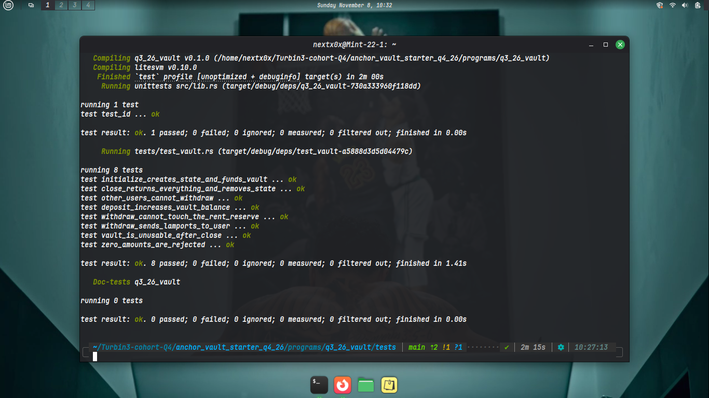

# Anchor Vault

A small Solana program, written with [Anchor](https://www.anchor-lang.com/), where each user gets their own SOL vault. A user can create a vault, deposit SOL into it, withdraw from it, and close it to get everything back. The program is tested with [LiteSVM](https://github.com/LiteSVM/litesvm), an in-process Solana runtime, so no local validator is needed.

I built this to understand how Solana programs hold and move funds, so this README also records what I implemented and what I learned along the way.

## What it does

| Instruction  | What happens                                                                              |
| ------------ | ----------------------------------------------------------------------------------------- |
| `initialize` | Creates the user's `vault_state` account and funds the vault with its rent-exempt minimum |
| `deposit`    | Moves SOL from the user into their vault                                                  |
| `withdraw`   | Moves SOL from the vault back to the user (never below the rent-exempt minimum)           |
| `close`      | Sends **everything** in the vault back to the user and closes `vault_state`               |

Every vault belongs to exactly one user. Nobody else can withdraw from or close it.

## Tech stack

| Tool    | Version | Used for                     |
| ------- | ------- | ---------------------------- |
| Rust    | 1.89.0  | The program and the tests    |
| Anchor  | 1.1.2   | Program framework            |
| LiteSVM | 0.10.0  | Running the tests in-process |

Program ID: `FCJqwrtEGzE66bLLTCqGgZd1yj1vyyJ6DsAFYjV9bJJP`

## How it works

### Two accounts per user

Each user has two program-derived addresses (PDAs), both derived from the user's public key:

| Account       | Seeds             | Owner          | Holds                                      |
| ------------- | ----------------- | -------------- | ------------------------------------------ |
| `vault_state` | `["state", user]` | This program   | The two bumps (`vault_bump`, `state_bump`) |
| `vault`       | `["vault", user]` | System Program | The SOL (lamports only, no data)           |

Because the user's key is part of the seeds, every user gets a different pair of addresses, and a different signer can never produce someone else's PDAs.

### State layout

```rust
#[account]
#[derive(InitSpace)]
pub struct VaultState {
    pub vault_bump: u8,
    pub state_bump: u8,
}
```

The account takes 10 bytes: 8 for Anchor's discriminator plus 1 byte for each bump. The bumps are stored once in `initialize`, so later instructions can use them directly instead of searching for them again.

### Who can move the money?

This is the core idea of the project:

- `vault_state` is owned by **my program**, so the program can change or close it directly (Anchor's `close = user`).
- `vault` is a PDA owned by the **System Program**. My program cannot subtract lamports from an account it does not own. It has to ask the System Program for a transfer, and the System Program requires the vault to **sign**.
- A PDA has no private key, so the program signs on its behalf by passing the seeds and bump to the System Program (`CpiContext::new_with_signer`). The runtime re-derives the address from the program ID and those seeds, and accepts the signature only if it matches.

That is why `deposit` uses `CpiContext::new` (the user is the sender and already signed the transaction) while `withdraw` and `close` use `CpiContext::new_with_signer` (the vault is the sender).

## Instructions

### `initialize`

- Creates `vault_state` (paid for by the user).
- Transfers the rent-exempt minimum for an empty account (about 890,880 lamports) from the user to the vault, so the vault exists and is rent-exempt from the start.
- Stores both bumps.

### `deposit(amount: u64)`

- Rejects `amount == 0` (`InvalidAmount`).
- Transfers `amount` lamports from the user to the vault (user signs).

### `withdraw(amount: u64)`

- Rejects `amount == 0` (`InvalidAmount`).
- Rejects any amount that would leave the vault below its rent-exempt minimum (`InsufficientFunds`). Only deposits can be withdrawn; getting the rent back is `close`'s job.
- Transfers `amount` lamports from the vault to the user, with the vault PDA signing through its seeds.

### `close`

- Transfers the vault's **entire** balance (deposits plus the rent reserve) to the user, with the vault PDA signing. At 0 lamports the runtime deletes the vault account at the end of the transaction.
- Closes `vault_state` with Anchor's `close = user`: the account is zeroed, reassigned to the System Program, and its rent goes to the user. This happens after the instruction body runs.
- After closing, a user can call `initialize` again to create a fresh vault.

## Errors

| Code | Name                | Message                                                        |
| ---- | ------------------- | -------------------------------------------------------------- |
| 6000 | `InvalidAmount`     | Amount must be greater than zero                               |
| 6001 | `InsufficientFunds` | Withdrawal would leave the vault below its rent-exempt minimum |

Anchor's own errors can also appear, for example `ConstraintSeeds` (2006) when the wrong user's accounts are passed, and `AccountNotInitialized` (3012) when `vault_state` does not exist.

## Project structure

```
.
├── Anchor.toml
├── Cargo.toml
├── rust-toolchain.toml
├── tests_passed.png                  <- screenshot of the passing tests
└── programs/q3_26_vault/
    ├── Cargo.toml
    ├── src/
    │   ├── lib.rs                    # program entrypoints
    │   ├── constants.rs              # PDA seeds ("vault", "state")
    │   ├── state.rs                  # VaultState account
    │   ├── error.rs                  # custom errors
    │   ├── instructions.rs
    │   └── instructions/
    │       ├── initialize.rs
    │       ├── deposit.rs
    │       ├── withdraw.rs
    │       └── close.rs
    └── tests/
        └── test_vault.rs             # LiteSVM tests for every instruction
```

### Build

```bash
anchor build
```

This produces `target/deploy/q3_26_vault.so`. **The tests load this file**, so rebuild whenever the program changes.

### Test

```bash
anchor test
```

`anchor test` builds the program and then runs `cargo test`, as set in `Anchor.toml`. You can also run the two steps yourself:

```bash
anchor build && cargo test
```

## Testing with LiteSVM

The tests use **[LiteSVM](https://github.com/LiteSVM/litesvm)**, a lightweight Solana runtime that runs inside the test process. Each test loads the compiled `.so`, airdrops SOL to a fresh user, sends real transactions, and reads the accounts back. There is no validator to start, and a test runs in milliseconds.

### What is covered

| Test                                         | What it checks                                                                                     |
| -------------------------------------------- | -------------------------------------------------------------------------------------------------- |
| `initialize_creates_state_and_funds_vault`   | `vault_state` exists and is owned by the program; the vault starts rent-exempt                     |
| `deposit_increases_vault_balance`            | The vault balance grows by exactly the deposited amount                                            |
| `zero_amounts_are_rejected`                  | `deposit(0)` and `withdraw(0)` fail with `InvalidAmount`                                           |
| `withdraw_sends_lamports_to_user`            | The vault shrinks by the amount; the user gains it minus the transaction fee                       |
| `withdraw_cannot_touch_the_rent_reserve`     | Withdrawing deposit + 1 lamport fails (`InsufficientFunds`); withdrawing exactly the deposit works |
| `other_users_cannot_withdraw`                | Another signer using the victim's PDAs fails with `ConstraintSeeds`; the vault is untouched        |
| `close_returns_everything_and_removes_state` | `vault_state` is gone, the vault is empty, and the user gets all lamports back minus the fee       |
| `vault_is_unusable_after_close`              | A deposit after `close` fails with `AccountNotInitialized`                                         |

### Testing notes

- **Build first.** The `.so` is embedded into the test binary with `include_bytes!` at compile time, so `target/deploy/q3_26_vault.so` has to exist before `cargo test`.
- **Fresh blockhash after every send.** LiteSVM rejects a transaction it has already seen (`AlreadyProcessed`), so the test helper calls `expire_blockhash()` after each send.
- **Fees matter.** The user pays a fee per transaction, so balance checks are written as `before + received - fee`, using the fee reported in the transaction metadata.
- **Checking why a transaction failed.** Anchor writes the error name into the program logs, so the tests assert on the log text instead of only checking that the transaction failed.

## Test results

All tests passing with LiteSVM:



## What I learned

**Solana accounts and ownership**

- Every account has an owner, and only the owner program can change its data or subtract its lamports.
- A System-owned account that holds only lamports can still be controlled by a program, but only through the System Program.

**PDAs and signing**

- A PDA is an address derived from a program ID and seeds. It has no private key.
- A program "signs" for a PDA by giving the runtime the seeds and bump. The runtime re-derives the address and accepts the signature only if it matches.
- Putting the user's key in the seeds ties each vault to its owner and makes cross-user access impossible by construction.
- Storing the bump once and passing it with `bump = vault_state.vault_bump` is cheaper than finding it on every call.

**Cross-program invocations (CPIs)**

- `deposit` uses `CpiContext::new` because the user's signature from the outer transaction carries through the CPI.
- `withdraw` and `close` use `CpiContext::new_with_signer` because the sender is a PDA.
- Signer seeds must exactly match the seeds in the account constraint, plus the bump. A mismatch means the runtime rejects the signature.

**Rent and closing accounts**

- Accounts must stay rent-exempt: the runtime refuses to leave an account with a balance above zero but below the minimum (about 890,880 lamports for an empty account).
- That is why `withdraw` only releases what is above the reserve, and `close` is the only way to get the reserve back.
- Anchor's `close = user` constraint zeroes the account, reassigns it, and refunds its rent. It only works for accounts the program owns, so the vault has to be drained with a signed transfer instead.
- An account that reaches 0 lamports is deleted by the runtime at the end of the transaction.

**Anchor constraints**

- `seeds` and `bump` validate that the account passed in is the one the program expects.
- Constraints run before the instruction body, which is why a wrong signer fails before any funds move.
- Anchor's error codes start at 6000 for custom errors, and the error name shows up in the program logs.

**Testing with LiteSVM**

- Loading a compiled program into an in-process runtime makes tests fast and fully deterministic.
- Good tests cover the happy path, the boundaries (exactly the withdrawable amount versus one lamport more), and the attack paths (wrong signer, use after close).
- Test failures are far easier to debug when the helper prints the program logs on error.
